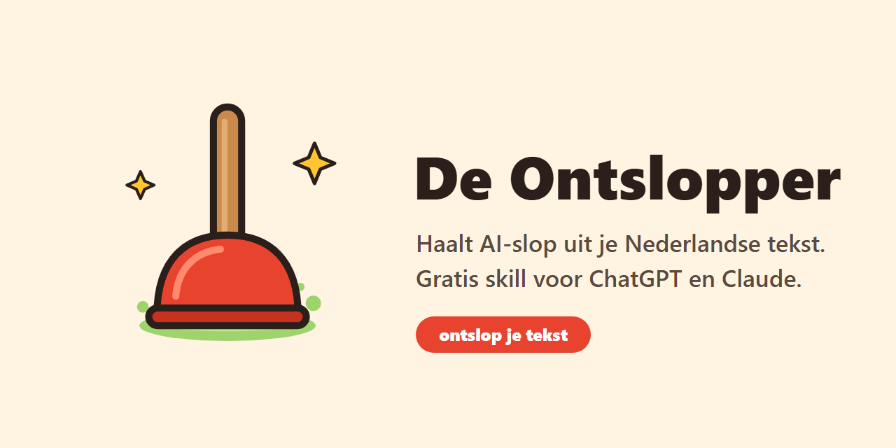
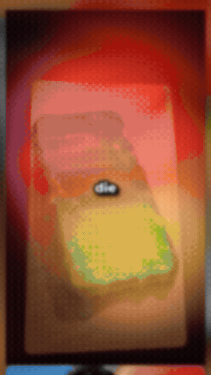
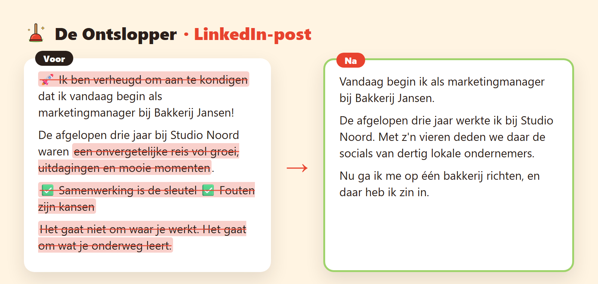
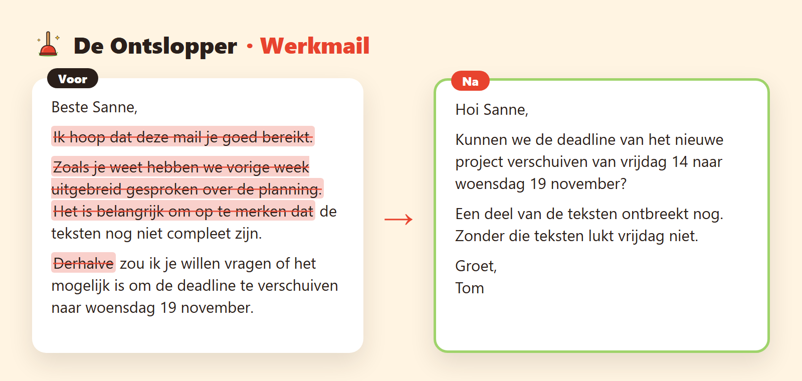
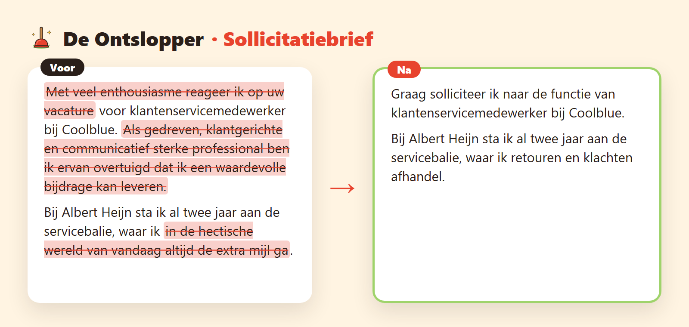

<p align="center">
  
</p>

<p align="center">
  <b>Gratis skill voor ChatGPT, Claude en Codex die AI-slop uit je Nederlandse tekst haalt.</b>
</p>

<p align="center">
  <a href="https://github.com/masharawi/ontslopper/releases/latest/download/ontslopper.zip"></a>
  &nbsp;
  <a href="chatgpt/instructies.md"></a>
</p>

<p align="center">
  <a href="#installeren">Installeren in 2 minuten</a> · <a href="voorbeelden/README.md">Voorbeelden</a> · <a href="SKILL.md">Alle regels</a>
</p>

---

Iedereen ziet tegenwoordig of een LinkedIn-post, mail of sollicitatiebrief door ChatGPT is geschreven. "Duik in de wereld van", "Het goede nieuws?", een lijstje met vinkjes en vijf hashtags te veel.

De Ontslopper haalt dat eruit. Hij herschrijft AI-tekst in het **Nederlands** tot tekst die klinkt als jij. Wat er staat, blijft staan. Er komt niets bij dat je niet zelf schreef.

<p align="center">
  
</p>

## Voor en na







Meer voorbeelden (werkmail, sollicitatiebrief, Instagram-caption) staan in [voorbeelden](voorbeelden/README.md).

## Waarom een Nederlandse

Er zijn inmiddels genoeg skills die afrekenen met AI-slop, maar ze zijn Engels. Op Nederlandse tekst gaan ze op twee manieren mis:

1. **Ze missen de Nederlandse verraders.** AI-Nederlands is vaak vertaald Engels: "Til je … naar een hoger niveau", "Ik hoop dat deze mail je goed bereikt", "de extra mijl gaan", een komma voor "en", functies Met Hoofdletters.
2. **Ze schrappen gewoon Nederlands.** "Daarnaast", "Bovendien", "Kortom" en "niet alleen … maar ook" staan op veel lijstjes met AI-woorden, maar mensen gebruiken ze ook. Dat is gemeten op duizenden Nederlandse teksten. De Ontslopper laat ze staan.

Daarnaast weet hij dat je een appje anders schrijft dan een sollicitatiebrief. Er zijn aparte regels voor LinkedIn-posts, werkmails, sollicitatiebrieven, Instagram- en TikTok-captions, appjes, nieuwsbrieven en blogs.

## Installeren

### ChatGPT

1. Open [`chatgpt/instructies.md`](chatgpt/instructies.md) en klik rechtsboven op het kopieericoon.
2. Maak in ChatGPT een **Project** (of een eigen GPT) en plak de tekst in de instructies.
3. Plak je tekst in een gesprek in dat project en zeg "ontslop dit". Klaar.

Liever niets instellen? Plak de instructies bovenaan een nieuw gesprek, met je tekst eronder.

### Claude (website en app)

1. Download [**ontslopper.zip**](https://github.com/masharawi/ontslopper/releases/latest/download/ontslopper.zip). Niet uitpakken.
2. Ga in Claude naar **Instellingen → Mogelijkheden** en upload de zip als skill.
3. Vraag daarna gewoon: "ontslop deze tekst" en plak je tekst.

### Claude Code

```bash
npx skills add masharawi/ontslopper --global --agent claude-code
```

Of als plugin:

```text
/plugin marketplace add masharawi/ontslopper
/plugin install ontslopper@ontslopper
```

### Codex

```bash
npx skills add masharawi/ontslopper --global --agent codex
```

## Gebruiken

Plak je tekst en zeg wat het is:

> Ontslop deze LinkedIn-post: (tekst)

Wil je dat het klinkt zoals jij schrijft? Geef er een stukje eigen tekst bij:

> Zo schrijf ik normaal: (een oude post of mail van jezelf). Ontslop deze mail in mijn stijl: (tekst)

Wil je zien wat er mis was? Vraag om de lijst met gevonden verraders.

**Tip:** laat een tekst van ChatGPT nakijken door Claude, en andersom. Een AI ziet zijn eigen gewoontes slecht, omdat hij ze zelf maakte.

## Wat het niet is

Geen AI-detector en geen manier om detectors te omzeilen. De Ontslopper maakt tekst beter leesbaar voor mensen. Of een tekst door AI is geschreven, kun je er niet mee bewijzen, en dat probeert hij ook niet.

## Meedoen

Zie je een Nederlandse AI-verrader die er niet in staat, of maakt De Ontslopper iets kapot? [Open een issue](../../issues/new/choose) met de tekst ervoor en erna.

## Bronnen

De Ontslopper bouwt voort op werk van anderen, allemaal onder de MIT-licentie:

- [blader/humanizer](https://github.com/blader/humanizer): de opbouw en de Engelse patronen, gebaseerd op Wikipedia's [Signs of AI writing](https://en.wikipedia.org/wiki/Wikipedia:Signs_of_AI_writing).
- [SametDemirtas/humanizer-lists](https://github.com/SametDemirtas/humanizer-lists): de gemeten Nederlandse patronen en welke woorden gewoon Nederlands zijn.
- [Nossie/humanize](https://github.com/Nossie/humanize): ambtelijk Nederlands en vertaald zakenjargon.

Zie [NOTICE.md](NOTICE.md).

## Gemaakt door

Fares Masharawi ([@faresgpt](https://www.instagram.com/faresgpt/)), [Sneller met AI](https://snellermet.ai). MIT-licentie.
